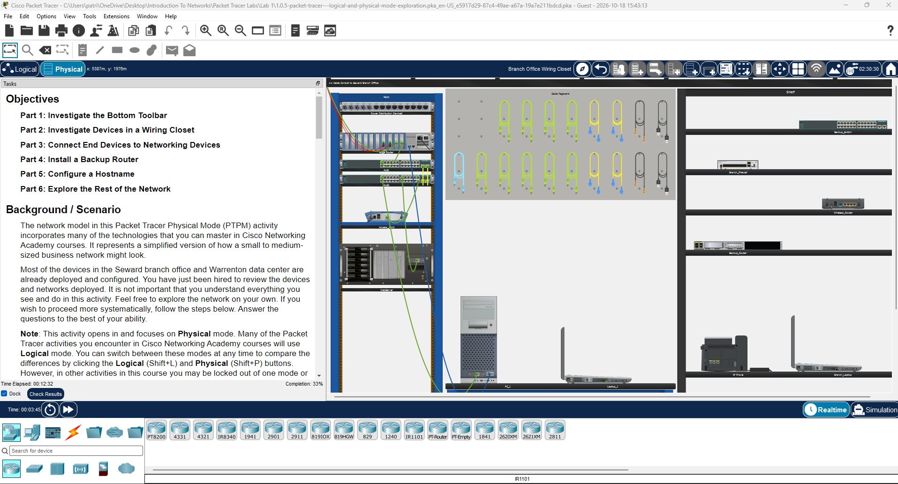

# Getting Started with Cisco Packet Tracer

**Cisco Networking Academy | Solent University**

Platform: Cisco Packet Tracer    
Focus Area: Network Simulation & Fundamentals 

## 🎯 Objective 

Become familiar with **Cisco Packet Tracer** and understand how it can be used to design, 
simulate, and troubleshoot computer networks.

## 🧠 What is Cisco Packet Tracer?  

**Cisco Packet Tracer** is a network simulation tool developed by Cisco that allows users to create, 
configure, and troubleshoot virtual computer networks without requiring physical networking equipment.

It provides a safe environment for students to practise networking concepts and develop practical skills 
throughout the CCNA course.

## 🖥️ Cisco Packet Tracer Interface

The screenshot below shows Cisco Packet Tracer in Physical Mode, where network devices, cabling, 
and equipment racks can be explored in a simulated environment.

## 🛠️ Key Features

- **Logical Workspace:** Design and visualize network topologies.
- **Physical Workspace:** Explore the physical layout of network devices.
- **Network Devices:** Simulate routers, switches, computers, servers, and wireless devices.
- **Realtime Mode:** Observe network operation in real time.
- **Simulation Mode:** Examine how data travels through a network.
- **Device Configuration:** Practise basic networking commands and configurations.

## 🔐 Security Relevance

Cisco Packet Tracer helps build foundational networking knowledge that is essential for understanding 
network security, identifying connectivity issues, and learning how network devices communicate.

## 📌 Key Takeaway

Cisco Packet Tracer provides a practical environment for applying networking theory.   
It will be used throughout the CCNA course to explore network configurations, protocols, and troubleshooting techniques.  