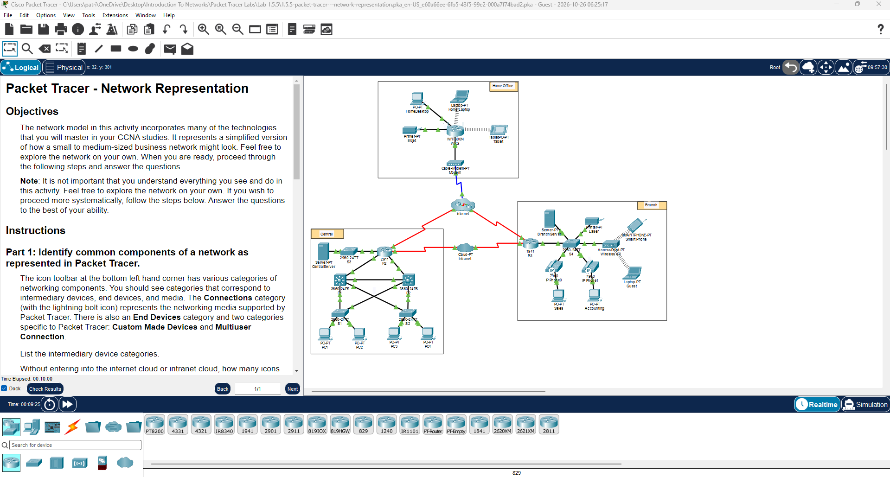

# Lab 01: Packet Tracer - Network Representation

**Cisco Networking Academy | Solent University**

Course: CCNA: Introduction to Networks
Platform: Cisco Packet Tracer    
Focus Area: 

## 🎯 Objective 
Identify common network components in Cisco Packet Tracer, understand their functions, and distinguish between LANs, WANs, endpoint devices, intermediary devices, and network media.

## 🧠 Core Concepts Learned
- Endpoint Devices and Intermediary Devices
- Network Media and Connection Types
- Client-Server and Peer-to-Peer Networks
- Switches and Routers
- LANs and WANs
- Internet and Intranet
- Home and Business Internet Connectivity

## 🧪 Lab Implementation

### Part 1: Identify common components of a network as represented in Packet Tracer.

**Question:** Without entering the Internet cloud or Intranet cloud, how many icons in the topology represent endpoint devices (only one connection leading to them)?

**Answer:** 15 endpoint devices.

**Home Office — 4 devices**

- 1 PC
- 1 Laptop
- 1 Printer
- 1 Tablet

**Central — 5 devices**

- 1 Server
- 4 PCs

**Branch — 6 devices**

- 1 Server
- 1 Printer
- 1 Smartphone
- 1 Laptop
- 2 PCs

> Note: IP phones are also considered end devices. However, the two IP phones in the Branch network each have two connections: one to the switch and another to a PC. Therefore, they are not included in this count because the question specifically asks for devices with only one connection.

--- 

**Question:** Without counting the two clouds, how many icons in the topology represent intermediary devices (multiple connections leading to them)?

**Answer:** 11 intermediary devices.

**Home Office — 4 devices**

- 1 Cable Modem
- 1 Wireless Router

**Central — 5 devices**

- 5 Switches
- 1 Router

**Branch — 6 devices**

- 2 Switches
- 1 Router

> Note: The wireless router in the Home Office combines the functions of a router, switch, and wireless access point, but it counts as only one intermediary device.

> Note: IP phones have two connections: one to the switch and another to a PC. They contain a built-in switch that forwards network traffic from the PC.
> However, IP phones are classified as endpoint devices, not intermediary devices. Having multiple connections does not necessarily make a device an intermediary device.

---

**Question:** How many end devices are not desktop computers?

**Answer:** 10 endpoint devices.

**Home Office — 3 endpoint devices**
- 1 Laptop
- 1 Printer
- 1 Tablet

**Central — 1 endpoint device**
- 1 Server

**Branch — 6 endpoint devices**
- 1 Server
- 1 Printer
- 1 Smartphone
- 1 Laptop
- 2 IP Phones

> Note: Desktop PCs and laptops are both endpoint devices, but they are different device types. 
> IP phones are included because they are also classified as endpoint devices, regardless of having two connections.

---

**Question:** How many different types of media connections are used in this network topology?

**Answer:** 4 types of media connections.
- Wireless (Wi-Fi) — Connects endpoint devices without physical cables using radio waves.
- Copper Ethernet — Connects PCs, switches, routers, and other network devices.
- Serial DTE/DCE — Used for WAN connections between routers.
- Coaxial Cable — Connects the cable modem to the Internet service provider (ISP).

### Part 2: Explain the purpose of the devices.

1. In Packet Tracer, only the **Server-PT device** can act as a server. Desktop or Laptop PCs cannot act as a server. Based on your studies so far, explain the client-server model. Perform an internet search if needed.

**Answer:** In a client-server network, clients request services or resources from a dedicated server.

- Central and Branch: Endpoint devices can act as clients of their dedicated servers.
- Home Office: There is no dedicated server, but the desktop PC could act as a server in a peer-to-peer (P2P) network, sharing resources with other devices.

> Note: In a peer-to-peer network, a device can act as both a client and a server.

--- 

2. List at least two functions of intermediary devices.

**Answer:**
- Switches: Connect devices within a LAN and use MAC addresses to find them.
- Routers: Connect different networks and use IP addresses and routing tables to determine the best path for forwarding packets.

---

3. List at least two criteria for choosing a network media type.

**Answer:**
- Speed and Bandwidth — The amount of data that needs to be transmitted.
- Device Compatibility — Whether devices support wired or wireless connections.
- Distance — How far the data needs to travel.
- Network Technology — The type of connection required, such as Ethernet, fiber-optic, coaxial, or wireless.

### Part 3: Compare and contrast LANs and WANs.

1. Explain the difference between a LAN and a WAN. Give examples of each.

**Answer:**
- LAN (Local Area Network) — Connects devices within a small geographical area, such as a home, office, or building.
- WAN (Wide Area Network) — Connects networks across larger geographical distances, such as different cities or countries.

In our topology, Home Office, Central, and Branch are three separate LANs. They can communicate across WAN connections, such as the Internet, using routers.

---

2. In the Packet Tracer network, how many WANs do you see?

**Answer:** 2 WANs.
- Internet — A public WAN connecting networks worldwide.
- Intranet — A private organizational network represented by the Intranet cloud, connecting different company locations.

---

3. How many LANs do you see? 

**Answer:** 3 LANs.
- Home Office — Home network.
- Central — Main office network.
- Branch — Branch office network.

---

4. The internet in this Packet Tracer network is overly simplified and does not represent the structure and form of the real internet. Briefly describe the internet.

**Answer:**
The Internet is a global network of interconnected networks, including LANs and WANs, that communicate using TCP/IP protocols.

---

5. What are some of the common ways a home user connects to the internet?

**Answer:**
- Mobile Broadband (4G/5G)
- Cable TV Broadband
- Telephone Line Broadband (DSL)
- Fiber-Optic Broadband
- Satellite Internet

---

6. What are some common methods that businesses use to connect to the internet in your area?

**Answer:**
- Business Broadband (FTTP) — Shared bandwidth provided by an ISP.
- Leased Line — Dedicated bandwidth with contracted speed and service guarantees.
- Satellite Internet — Internet connectivity through satellites.
- Mobile Broadband (4G/5G) — Wireless Internet access through cellular networks.
- Metro Ethernet — Connects business locations through an Ethernet-based WAN and can also provide Internet access through an ISP.

## 🧰 Tools Used
- Cisco Packet Tracer
- Cisco Networking Academy (NetAcad)

## 🔐 Security Relevance
- Understanding network topology helps identify devices and potential entry points.
- Routers and switches play important roles in controlling and directing network traffic.
- Separating private networks from public networks helps protect internal resources.
- Understanding network connections is essential for identifying potential security risks.

## 📌 Lessons Learned
- Learned to identify endpoint and intermediary devices in a network topology.
- Understood the differences between switches and routers.
- Learned how client-server and peer-to-peer networks operate.
- Identified different network media and their purposes.
- Understood the differences between LANs, WANs, the Internet, and intranets.
- Explored common Internet connection methods for homes and businesses.

 