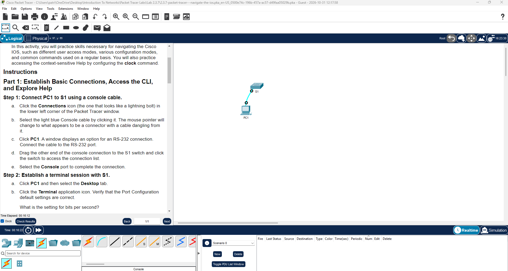
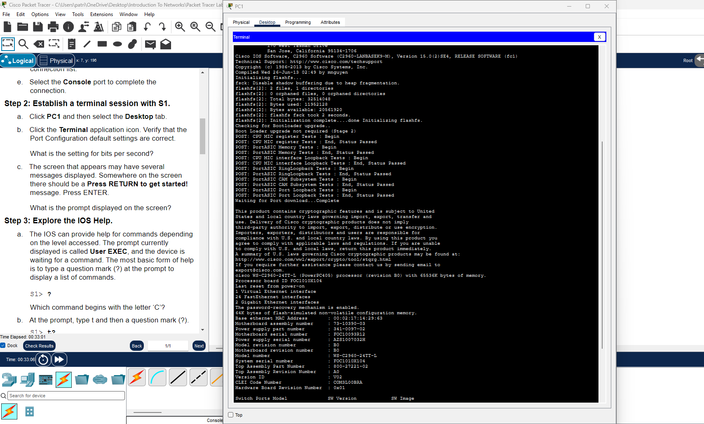

# Lab 01: Packet Tracer - Navigate the IOS

**Cisco Networking Academy | Solent University**

Course: CCNA: Introduction to Networks
Platform: Cisco Packet Tracer    
Focus Area: Console Access, Cisco IOS CLI, EXEC Modes, Context-Sensitive Help & Clock Configuration

## 🎯 Objective 

- Establish a console connection and access the Cisco IOS CLI.
- Explore User EXEC, Privileged EXEC, and Global Configuration modes.
- Use context-sensitive help and command completion.
- Configure and verify the system clock.
- Identify common Cisco IOS command errors.

## 🧪 Lab Implementation

### Part 1: Establish Basic Connections, Access the CLI, and Explore Help

**Step 1: Connect PC1 to S1**

Connect PC1 (RS-232) to S1 (Console port) using a console cable 



**Step 2: Establish a terminal session with S1**

Opened the Terminal application on PC1 to access the S1 switch through the console connection.

- Bits per second: 9600
- CLI prompt: S1>



**Step 3: Explore Cisco IOS Help**

Used context-sensitive help to identify available commands.

```Text
S1> ?    - Displays commands available in the current mode.
S1> t?   - Displays commands beginning with t.
S1> te?  - Displays commands beginning with te.
```

---

### Part 2: Explore EXEC Modes

**Step 1:  Enter Privileged EXEC Mode**

Used the enable command to switch from User EXEC mode to Privileged EXEC mode.

```Text
S1> enable  - User EXEC mode.
S1#         - Privileged EXEC mode.
```

NOTE: Explored command completion using the Tab key

**Step 2: Enter Global Configuration Mode**

Used the configure terminal command to enter Global Configuration mode.

```Text
S1# configure terminal      - Enable Global Configuration mode
S1(config)# exit            - Returns to Privileged EXEC mode.
S1#                         - Back to Privileged EXEC mode.
```
---

### Part 3: Set the Clock

**Step 1: Configure the System Clock**

Checked the current system time and explored the syntax of the clock command using context-sensitive help.

```Text
S1# show clock
S1# clock
S1# clock ?
S1# clock set ?
S1# clock set 15:00:00 ?
```

Configured the switch clock to 15:00 on 31 JAN 2035, as required by the lab.

```Text
S1# clock set 15:00:00 31 JAN 2035
S1# show clock
```

NOTE: The show clock command verifies the configured date and time.

**Step 2: Explore Cisco IOS Command Errors**

Tested incomplete and invalid commands to understand Cisco IOS error messages.

```Text
S1# cl
S1# clock
S1# clock set 25:00:00
S1# clock set 15:00:00 32
```

Cisco IOS messages include:
- % Incomplete command. — The command requires additional parameters.
- % Invalid input detected at '^' marker. — The command contains invalid syntax or an unsupported value.
- % Ambiguous command. — The command abbreviation is not sufficiently specific.

## 🧰 Tools Used
- Cisco Packet Tracer
- Cisco IOS Command-Line Interface (CLI)
- Console Cable
- PC Terminal Application
- Cisco Switch (S1)

## 🔐 Security Relevance
- Console connections provide direct administrative access to network devices.
- Cisco IOS command modes separate basic monitoring from privileged configuration access.
- Understanding CLI commands and error messages helps administrators configure and troubleshoot network devices securely.

## 📌 Lessons Learned

- Learned to establish a console connection to a Cisco switch.
- Understood the differences between User EXEC, Privileged EXEC, and Global Configuration modes.
- Practised using context-sensitive help and command completion.
- Learned to configure and verify the system clock.
- Identified common Cisco IOS command errors and their meanings.

 