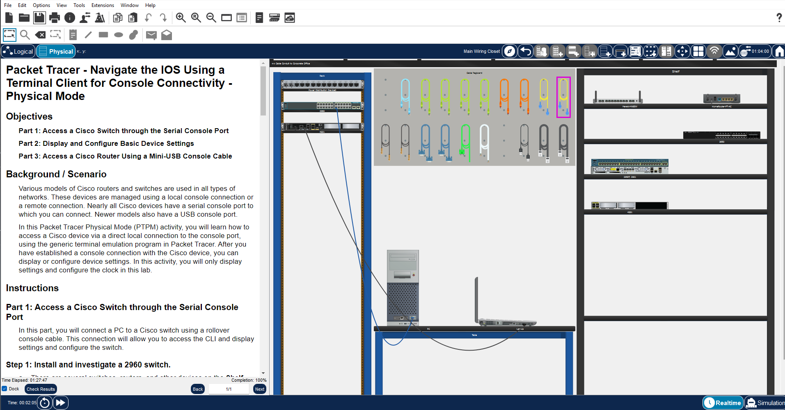

# Lab 02: Packet Tracer - Navigate the IOS Using a Terminal Client for Console Connectivity

**Cisco Networking Academy | Solent University**

Course: CCNA: Introduction to Networks
Platform: Cisco Packet Tracer    
Focus Area: Console Connectivity, Cisco IOS CLI, Device Verification & Clock Configuration 

## 🎯 Objective 

- Establish console connections to Cisco switches and routers.
- Access the Cisco IOS CLI using a terminal application.
- Explore User EXEC and Privileged EXEC modes.
- Display device information and configure the system clock.
- Compare serial and USB console connections.


## 🧪 Lab Implementation

### Part 1: Access a Cisco Switch Through the Serial Console Port

**Step 1: Install and Inspect a Cisco 2960 Switch**

Installed the Cisco 2960 switch in the equipment rack and inspected its network interfaces and console port.

**Step 2: Install and Inspect the PC**

Installed a PC on the table, powered it on, and identified its RS-232 and USB interfaces.

**Step 3: Establish a Serial Console Connection**

Connected the PC (RS-232) to the switch (Console port) using a rollover console cable.

**Step 4: Access the Cisco IOS CLI**

Opened the Terminal application on the PC using the default console settings.
```text
Switch>
```

### Part 2: Display and Configure Basic Device Settings

**Step 1: Display the Cisco IOS Version**

Used the show version command to display information about the switch's IOS software.
```text
Switch> show version
```

**Step 2: Configure the System Clock**

Checked the current system time and entered Privileged EXEC mode.
```text
Switch> show clock
Switch> enable
Switch#
```

Used context-sensitive help to explore the clock command syntax.
```text
Switch# clock set ?
Switch# clock set 15:28:00 ?
```

Configured the system clock using the date and time specified in the lab.
```text
Switch# clock set 15:28:00 Nov 11 2020
Switch# show clock
```


### Part 3: Access a Cisco Router Using a Mini-USB Console Cable

**Step 1: Install and Inspect a Cisco 4321 Router**

Installed the Cisco 4321 router in the equipment rack, powered it on, and identified its console interfaces.

**Step 2: Install and Inspect the Laptop**

Installed a laptop on the table, powered it on, and identified its USB interfaces.

**Step 3: Establish a USB Console Connection**

Connected the laptop to the router's mini-USB console port using a USB cable.

**Step 4: Access the Router CLI**

Opened the Terminal application on the laptop and declined the initial configuration dialog.
```text
Would you like to enter the initial configuration dialog? [yes/no]: n
Press RETURN to get started!
Router>
```

> NOTE: Both serial and USB console connections provide local administrative access to Cisco devices without requiring an IP network connection.




## Reflection Questions

**Question 1: How can unauthorized console access be prevented?**

Answer:

We can protect console access by setting up a password and requiring authentication before someone can access the device. It's also important to keep network equipment in a secure location to prevent unauthorized physical access.

**Question 2: What are the advantages and disadvantages of serial versus USB console connections?**

Answer:

- Serial Console: Works with most traditional Cisco devices and usually doesn't require additional drivers. However, modern laptops may need a USB-to-serial adapter.
- USB Console: Easier to use with modern laptops because they already have USB ports. However, it may require additional drivers and isn't supported by every device.

> NOTE: Both connections allow us to configure and troubleshoot devices directly without an Internet connection. The main disadvantage is that we usually need to be physically close to the device.

## 🧰 Tools Used
- Cisco Packet Tracer (Physical Mode)
- Cisco IOS Command-Line Interface (CLI)
- Packet Tracer Terminal Application
- Cisco 2960 Switch
- Cisco 4321 Router
- PC and Laptop
- Rollover Console Cable
- Mini-USB Console Cable

## 🔐 Security Relevance
- Console connections provide direct administrative access to network devices.
- Physical access to console ports should be restricted to authorized personnel.
- Console authentication helps prevent unauthorized configuration changes.
- Accurate system time supports troubleshooting and the interpretation of security logs.

## 📌 Lessons Learned

- Learned to establish serial and USB console connections.
- Practised accessing Cisco IOS through a terminal application.
- Used show version to inspect Cisco IOS software information.
- Configured and verified the system clock.
- Understood the importance of protecting physical console access.


 