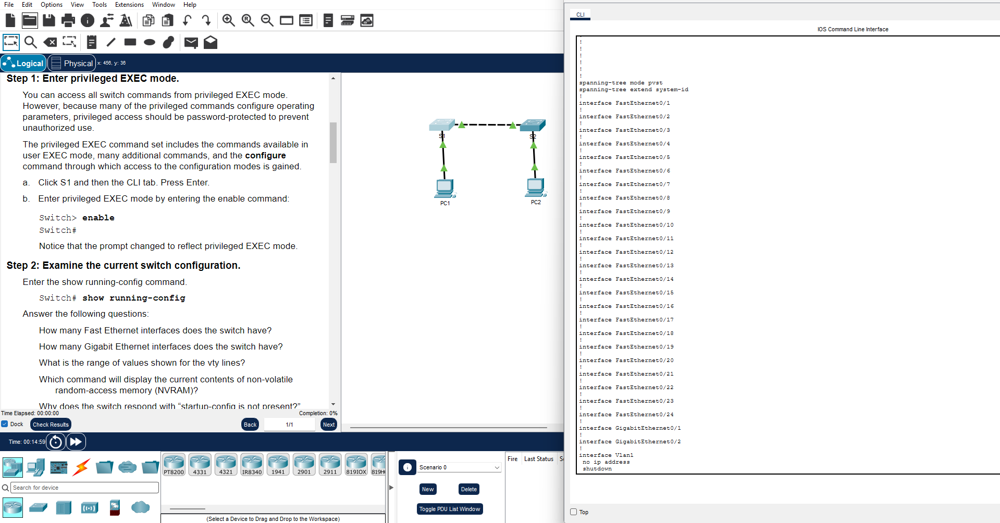

# Lab 03: Packet Tracer - Configure Initial Switch Settings

**Cisco Networking Academy | Solent University**

Course: CCNA: Introduction to Networks
Platform: Cisco Packet Tracer    
Focus Area: 

## 🎯 Objective 

- Verify the Default Switch Configuration
- Configure a Basic Switch Configuration
- Configure a MOTD Banner
- Save Configuration Files to NVRAM

## 🧪 Lab Implementation

### Part 1: Verify the Default Switch Configuration

Entered Privileged EXEC mode and examined the switch's default configuration.

```text
Switch> enable
Switch# show running-config
```



**Default Switch Information:**

- Fast Ethernet interfaces: 24
- Gigabit Ethernet interfaces: 2
- VTY lines: 0–15 (displayed in ranges 0–4 and 5–15)

> Note: The message startup-config is not present indicates that no startup configuration has been saved in NVRAM yet.

**Running Configuration and Startup Configuration**

- 'show running-config'                - Displays the active configuration stored in RAM.
- 'show startup-config'                - Displays the saved configuration stored in NVRAM.
- 'copy running-config startup-config' - Saves the current configuration to NVRAM.

---

### Part 2: Create a Basic Switch Configuration

** STEP 1: Configure the Switch Hostname**

Changed the default switch hostname to `S1`.

```text
Switch> enable
Switch# configure terminal
Switch(config)# hostname S1
S1(config)# exit
S1#
```

- `enable` - Enters Privileged EXEC mode.
- `configure terminal` - Enters Global Configuration mode.
- `hostname S1` - Changes the switch hostname to S1.
- `exit` - Exits Global Configuration mode and returns to Privileged EXEC mode.

**STEP 2: Secure Console Access**

Configured a console password and enabled password authentication.

```text
S1# configure terminal
S1(config)# line console 0
S1(config-line)# password letmein
S1(config-line)# login
S1(config-line)# end
```

- `line console 0` - Enters console line configuration mode.
- `password letmein` - Sets the console password.
- `login` - Requires password authentication when accessing the console.

**Verify Console Authentication**

Exited the console session and reconnected to confirm that the switch requests a password.

```text
S1# exit

User Access Verification
Password:
S1>
```

> **Note:** When someone connects to the switch through the console port, they must enter 'letmein' before they can access the CLI.

**STEP 3: Secure Privileged EXEC Access**

Configured a password to restrict access to **Privileged EXEC mode**.

```text
S1# configure terminal
S1(config)# enable password c1$c0
S1(config)# end
S1#
```

- `enable password c1$c0` - Configures a password required to enter Privileged EXEC mode.
- `end` - Returns directly to Privileged EXEC mode.

**Verify Privileged EXEC Authentication**

Exited Privileged EXEC mode and attempted to access it again.

```text
S1# disable
S1> enable
Password:
S1#
```

- `disable` - Returns to User EXEC mode.
- `enable` -  Requests access to Privileged EXEC mode.
- `Password:` - Confirms that password authentication is required.

**STEP 4. Configure an Enable Secret Password**

Configured an `enable secret` password to provide stronger protection for **Privileged EXEC access**.

```text
S1# configure terminal
S1(config)# enable secret itsasecret
S1(config)# end
S1#
```

- `enable secret itsasecret` - Configures a securely hashed password for Privileged EXEC access.
- `enable secret` takes priority over `enable password` when both are configured.

**Verify the Enable Secret Configuration**

```text
S1# show running-config
```

The running configuration displays the `enable secret` as a hash rather than the original plaintext password.

> **Note:** The `enable password` and `enable secret` commands both protect Privileged EXEC mode, but `enable secret` provides stronger password storage and is the preferred option.

**STEP 5: Protect Passwords in the Configuration**

Enabled password encryption to prevent supported plaintext passwords from being displayed directly in the configuration.

```text
S1# configure terminal
S1(config)# service password-encryption
S1(config)# end
S1# show running-config
```

- `service password-encryption` - Hides passwords in the configuration so they are not displayed as plain text.
- `show running-config` - Verifies how the passwords are stored.

> **Security Note:** `service password-encryption` uses weak, reversible encryption for traditional line passwords and `enable password`. It does not provide the same protection as `enable secret`.

---

### Part 3: Configure a MOTD (Message of the Day) Banner

Configured a Message of the Day (MOTD) banner to display a security warning when someone connects to the switch.

```text
S1# configure terminal
S1(config)# banner motd "This is a secure system. Authorized Access Only!"
S1(config)# exit
S1#
```

- `configure terminal` - Enters Global Configuration mode.
- `banner motd` -  Configures a message displayed when someone connects to the switch.
- `" "` - The quotation marks act as delimiters, marking the beginning and end of the message.
- `exit` - Returns to Privileged EXEC mode.

**Verify the MOTD Banner**

Exited the console session and reconnected to verify that the banner appears before the password prompt.

```text
This is a secure system. Authorized Access Only!

User Access Verification

Password:
```

---

### Part 4: Save and Verify Configuration Files to NVRAM

Saved the switch configuration to NVRAM to ensure that the hostname, passwords, and MOTD banner are preserved after a restart.

**1. Save the Running Configuration**

```text
S1# copy running-config startup-config
Destination filename [startup-config]?
Building configuration...
[OK]
```

- `copy running-config startup-config` - Copies the active configuration from RAM to NVRAM.
- `Destination filename [startup-config]?` - Press Enter to accept the default filename.
- `[OK]` - Confirms that the configuration was saved successfully.

**2. Verify the Saved Configuration**

```text
S1# show startup-config
```

- `show startup-config` - Displays the configuration saved in NVRAM.

Verified that the saved configuration includes the switch hostname, console authentication settings, Privileged EXEC password settings, and MOTD banner.

**Running Configuration vs. Startup Configuration**

- `running-config` — The active configuration stored in RAM. Changes take effect immediately but are not automatically saved.
- `startup-config` — The saved configuration stored in NVRAM. Cisco IOS loads it when the switch restarts.

> **Note:** If the switch restarts without saving the running configuration, any unsaved changes will be lost.

## 🧰 Tools Used
- Cisco Packet Tracer
- Cisco IOS Command-Line Interface (CLI)
- Cisco 2960 Switch
- Console Connection

## 📌 Lessons Learned

- Examined the default switch configuration using `show running-config`.
- Changed the switch hostname using the `hostname` command.
- Configured console password authentication to restrict access to the switch.
- Secured Privileged EXEC mode and learned the difference between `enable password` and `enable secret`.
- Used `service password-encryption` to hide plaintext passwords in the configuration.
- Configured and verified an MOTD banner.
- Saved the running configuration to NVRAM and verified it using `show startup-config`.


## 🔐 Security Relevance

- Console authentication helps prevent unauthorized access to the switch.
- `enable secret` provides stronger protection for Privileged EXEC mode than `enable password`.
- `service password-encryption` hides supported plaintext passwords, but its encryption is weak and can be reversed.
- MOTD banners warn users that access is restricted to authorized personnel.
- Saving the configuration to NVRAM ensures that security settings remain in place after a restart.