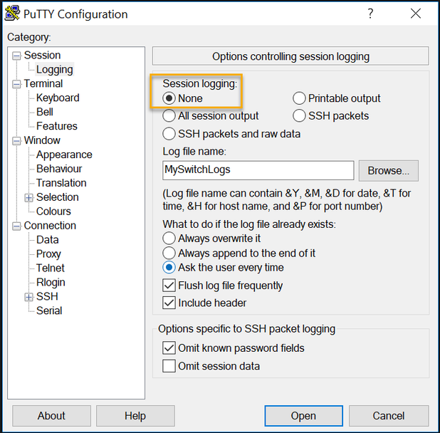

# 🌐 2.5 Save Configuration

**Cisco Networking Academy | Solent University**

**Course:** CCNA: Introduction to Networks  
**Module:** 02 - Basic Switch and End Device Configuration    
**Focus Area:** Configuration Files, Saving Changes & Configuration Backups  

## 🎯 Objective 

- Understand the difference between running and startup configurations.
- Save configuration changes so they remain after a device restart.
- Restore or discard configuration changes.
- Capture device configurations in a text file for documentation.

## 🧠 2.5.1 Configuration Files

Cisco IOS uses two main configuration files:

### Running Configuration (running-config)

- Stored in RAM.
- Contains the device's currently active configuration.
- Changes take effect immediately.
- Unsaved changes are lost when the device restarts.

### Startup Configuration (startup-config)

- Stored in NVRAM (Non-Volatile Random Access Memory).
- Contains the saved configuration used when the device starts.
- Remains available after a restart.

**To view the configuration files:**
```text
Switch# show running-config
Switch# show startup-config
```

**To save the running configuration:**
```text
Switch# copy running-config startup-config
```
This command copies the current configuration from RAM to NVRAM so that changes are preserved after a restart.

## 🧠 2.5.2 After the Running Configuration

Changes made to the running configuration take effect immediately, but they are not automatically saved.

If the changes **work correctly**, save them using:
```text
Switch# copy running-config startup-config
```

If the changes **cause problems**, there are two common options.

**Option 1: Remove individual changes**

Use the appropriate no command to reverse a configuration command.

Example:
```text
Switch(config)# no hostname
```
This removes the configured hostname and restores the default device name.

**Option 2: Discard all unsaved changes**
```text
Switch# reload
```
When prompted to save the modified configuration, choose no.

The device restarts and loads the previously saved startup configuration.

> NOTE: Reloading interrupts network services. Any unsaved configuration changes will be lost if they are not saved before the restart.

**Option 3: Delete the saved configuration**
```text
Switch# erase startup-config
Switch# reload
```
This deletes the saved configuration and restarts the device without loading the previous startup configuration.

## 🧠 2.5.3 Capture Configuration to a Text File

Cisco IOS allows administrators to display the device configuration and save a copy as a text file on their computer.

The saved file can be used to review device settings or document the network configuration.

**Example:**
```text
Switch# show running-config
```

This command displays the current configuration on the terminal screen.

Using terminal software such as PuTTY or Tera Term, administrators can capture this output and save it as a `.txt` file.



> **NOTE:** Saving a configuration to a text file is different from saving it to NVRAM. The text file is stored on the administrator's computer, not on the switch.

> NOTE: Configuration files may contain sensitive information, such as passwords, usernames and network addresses. Store captured files securely.

## 📌 Key Concepts to Remember

- Running Configuration: The active configuration stored in RAM.
- Startup Configuration: The saved configuration stored in NVRAM.
- Saving Changes: 'copy running-config startup-config' preserves configuration changes after a restart.
- Discarding Changes: Reloading without saving restores the previously saved configuration.
- Configuration Capture: Terminal software can save configuration output to a text file.

## 🔐 Security Relevance

- Saving configurations ensures security settings remain active after a restart.
- Configuration backups help administrators document and recover device settings.
- Captured configuration files must be protected because they may contain sensitive network information.
