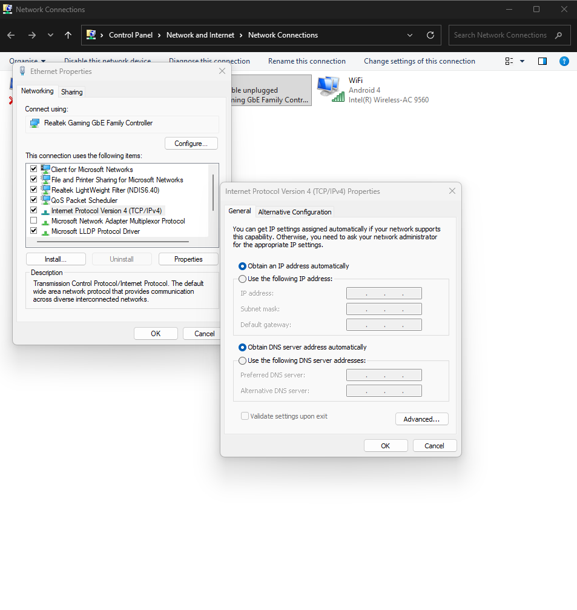

# 🌐 2.7 Configure IP Addressing

**Cisco Networking Academy | Solent University**

**Course:** CCNA: Introduction to Networks  
**Module:** 02 - Basic Switch and End Device Configuration  
**Focus Area:** Manual IP Configuration, DHCP & Switch Virtual Interfaces

## 🎯 Objective

- Configure IP addresses manually on end devices.
- Understand how DHCP automatically assigns IP settings.
- Configure a Switch Virtual Interface (SVI) for remote management.
- Verify IP addressing and network connectivity.

## 🧠 2.7.1 Manual IP Address Configuration for End Devices

End devices such as PCs and laptops need an IP address to communicate over an IP network.

**Manual IP configuration (Static IP)** means the administrator enters the network settings manually.

The main IPv4 settings are:

- **IP Address:** Identifies the device's network interface.
- **Subnet Mask:** Identifies the network and host portions of an IPv4 address.
- **Default Gateway:** The router address used to reach other networks.
- **DNS Server:** Translates domain names into IP addresses.

**Example:**

```text
IP Address:       192.168.1.10
Subnet Mask:      255.255.255.0
Default Gateway:  192.168.1.1
DNS Server:       8.8.8.8
```

**In Cisco Packet Tracer:**

1. Select a PC.
2. Open Desktop → IP Configuration.
3. Select Static.
4. Enter the IPv4 address, subnet mask, default gateway and DNS server.

> **NOTE:** Static IP addresses remain configured until they are manually changed.

## 🧠 2.7.2 Automatic IP Address Configuration for End Devices

**DHCP (Dynamic Host Configuration Protocol)** automatically provides IP configuration settings to devices on a network.

Instead of configuring each device manually, a DHCP server can assign an IP address, subnet mask, default gateway and DNS server.

**In Cisco Packet Tracer:**

1. Select a PC.
2. Open **Desktop → IP Configuration**.
3. Select **DHCP**.
4. The PC requests IP configuration from a DHCP server.

> **NOTE:** A DHCP server must be available and reachable for automatic configuration to work.

DHCP is useful for networks with many devices because it reduces manual configuration and helps prevent addressing mistakes.

## 🧠 2.7.3 Configure IP Addressing on a Windows PC

These settings can be configured through the network adapter's IPv4 properties.

**Access IPv4 Settings**

1. Open Control Panel → Network and Internet → Network Connections.
2. Right-click the Ethernet or Wi-Fi adapter and select Properties.
3. Select Internet Protocol Version 4 (TCP/IPv4).
4. Click Properties.



Here, you can manually enter the IP configuration details or choose to obtain an IP address automatically using DHCP.

## 🧠 2.7.4 Switch Virtual Interface Configuration

A **Switch Virtual Interface (SVI)** is a logical interface associated with a VLAN.

On a Layer 2 switch, an SVI can be assigned an IP address to allow remote management using protocols such as SSH.

Unlike physical Ethernet interfaces, an SVI does not require its own physical port.

**Example: Configure a management IP address on VLAN 1**

```text
Switch> enable
Switch# configure terminal
Switch(config)# interface vlan 1
Switch(config-if)# ip address 192.168.1.2 255.255.255.0
Switch(config-if)# no shutdown
Switch(config-if)# exit
Switch(config)# ip default-gateway 192.168.1.1
Switch(config)# end
```

- `interface vlan 1` — Enters the SVI configuration mode for VLAN 1.
- `ip address` — Assigns an IPv4 address and subnet mask to the SVI.
- `no shutdown` — Administratively enables the interface.
- `ip default-gateway` — Configures the gateway for management traffic to other networks.

**Verify the configuration:**

```text
Switch# show ip interface brief
```

This displays the switch interfaces, their IP addresses and their operational status.

> **NOTE:** The SVI must have an active VLAN and an operational Layer 2 connection in that VLAN to become operational. Configuring an IP address alone does not enable SSH.

## 📌 Key Concepts to Remember

- **Static IP:** Network settings configured manually.
- **DHCP:** Automatically provides IP configuration to devices.
- **Default Gateway:** Allows devices to communicate with other networks.
- **SVI:** A virtual interface that can provide an IP address for switch management.
- **`no shutdown`:** Administratively enables an interface.
- **`show ip interface brief`:** Displays interface IP addresses and status.

## 🔐 Security Relevance

- Correct IP configuration helps administrators manage and identify network devices.
- DHCP reduces manual configuration mistakes but should be protected against unauthorised DHCP servers.
- Switch management interfaces should be accessible only to authorised administrators.
- SSH should be used instead of Telnet for secure remote management.

