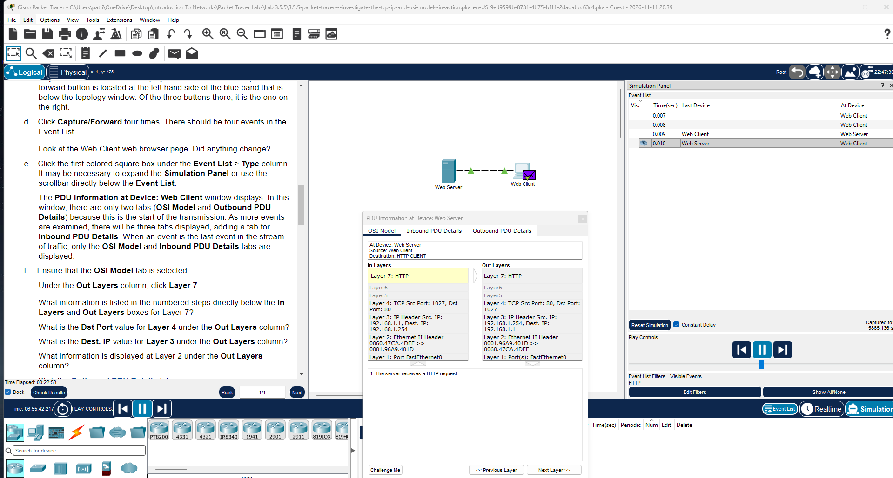
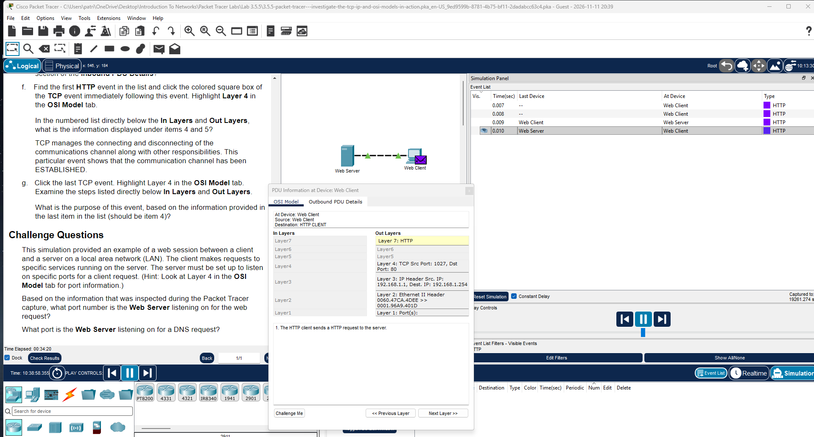
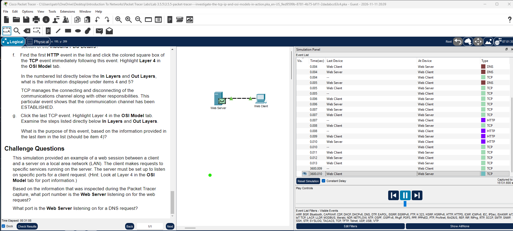

# Lab 02: Packet Tracer - Investigate the TCP/IP and OSI Models in Action

**Cisco Networking Academy | Solent University**

Course: CCNA: Introduction to Networks  
Platform: Cisco Packet Tracer  
Focus Area: OSI Model, TCP/IP, Encapsulation & Network Traffic Analysis

## 🎯 Objective

Understand how data travels between a client and a server by examining network traffic using Packet Tracer Simulation Mode.

## 🧪 Lab Implementation

### Part 1: Examine HTTP Web Traffic

Switched Packet Tracer from Realtime Mode to Simulation Mode and selected HTTP in the Event List Filters.

Opened the Web Client browser and entered: `www.osi.local`

Used **Capture/Forward** to follow the HTTP traffic between the client and the web server.

Examined the OSI Model tab to understand how the data moves through the different networking layers.

### Part 2: Examine Encapsulation

Opened the Outbound PDU Details tab to examine the information added to the data before transmission.

| OSI Layer | Information Examined |
|---|---|
| Layer 7 – Application | HTTP request |
| Layer 4 – Transport | TCP source and destination ports |
| Layer 3 – Network | Source and destination IP addresses |
| Layer 2 – Data Link | Source and destination MAC addresses |
| Layer 1 – Physical | Transmission of bits |

### Part 3: Examine Other Network Protocols

Enabled additional protocol filters to investigate how different protocols work together.

- **DNS:** Resolves the website name into an IP address.
- **ARP:** Finds the MAC address needed for local network communication.
- **TCP:** Establishes and closes the connection between the client and server.
- **HTTP:** Transfers the web request and response.

## 🧰 Tools Used

- Cisco Packet Tracer
- Packet Tracer Simulation Mode
- Web Client and Web Server
- OSI Model and PDU Details
- Event List Filters

## 📌 Lessons Learned

- Learned how to follow network traffic using Simulation Mode.
- Understood how the OSI and TCP/IP models relate to real network communication.
- Examined encapsulation and decapsulation.
- Identified MAC addresses, IP addresses, and TCP ports inside PDUs.
- Learned how DNS, ARP, TCP, and HTTP work together when accessing a webpage.

## 🔐 Security Relevance

- Inspecting network traffic helps identify how devices communicate.
- Understanding protocols and ports is important when configuring firewalls and access control lists.
- Examining packets helps troubleshoot suspicious or unexpected network activity.
- Understanding encapsulation provides a foundation for packet analysis using tools such as Wireshark.