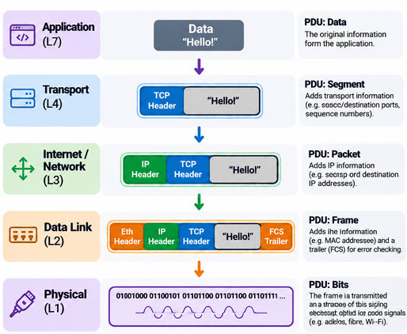

# 🌐 3.6 Data Encapsulation

**Cisco Networking Academy | Solent University**

**Course:** CCNA: Introduction to Networks  
**Module:** 03 - Protocols and Models  
**Focus Area:** Message Segmentation, Sequencing, PDUs and Data Encapsulation

## 🎯 Objective

Understand how large messages are divided into smaller parts, how sequencing helps reconstruct them, and how data is encapsulated and de-encapsulated as it travels between network devices.

## 🧠 3.6.1 Segmenting Messages

**Segmentation** is the process of dividing large messages into smaller pieces before sending them across a network.

Instead of sending an entire file as one large message, the data is divided into smaller parts that can travel through the network.

**Why is segmentation important?**

- **Efficiency:** Smaller pieces allow different communications to share the network.
- **Different Routes:** Packets from the same message can travel through different network paths to reach their destination. They may arrive out of order and need to be reassembled correctly.
- **Reliability:** If data is lost, reliable protocols such as TCP can retransmit the missing part instead of the entire file.
- **Network Limits:** Networks have limits on how much data can be carried in a single frame or packet.

**Example:**
- Imagine sending a large photograph to a friend.
- Instead of sending the entire photograph as one enormous message, your computer divides the data into smaller pieces.
- These pieces travel across the network and are reconstructed at the destination.

**Multiplexing** allows pieces of different communications to share the same network connection.

**Example:**
- You can browse a website while downloading a file because their traffic can be interleaved.

## 🧠 3.6.2 Sequencing

When a message is divided into smaller pieces, the receiving device may need to put them back in the correct order.

**Sequencing** helps identify the order of the data so it can be reconstructed correctly.

**Example:**
- Imagine sending a book as separate numbered pages.
- If the pages arrive in this order: **Page 3 → Page 1 → Page 2**
- You can still reconstruct the book correctly because the pages are numbered.

TCP uses **sequence numbers** to track the position of data within a communication.

TCP can reorder data that arrives out of order and identify missing data so it can be retransmitted.

> NOTE: UDP does not provide built-in sequencing, retransmission or guaranteed delivery.

## 🧠 3.6.3 Protocol Data Units

A **Protocol Data Unit (PDU)** is the name given to data at a particular networking layer.

As data moves down the layers, each layer adds the information needed for its job, and the resulting data unit is given a **different PDU name**.

Data → Segment/Datagram → Packet → Frame → Bits. This is the sequence for TCP-based communication.

> NOTE: If the Transport header is TCP, then it is a segment. 
> If the Transport header is UDP then it is a datagram.

## 🧠 3.6.4 Encapsulation Example

**Encapsulation** is the process of adding protocol information to data as it moves down the networking layers before transmission.

**Example: Opening a Website**
1. **Application:** Your browser creates a web request.
2. **Transport:** TCP adds information such as port numbers, creating a segment.
3. **Internet:** IP adds source and destination IP addresses, creating a packet.
4. **Data Link:** Ethernet adds a frame header and trailer, including MAC addressing and error-detection information.
5. **Physical:** The frame is transmitted as bits represented by electrical, optical or radio signals.

**Remember:**
- **Transport:** Adds TCP or UDP information.
- **Internet:** Adds IP addressing information.
- **Data Link:** Adds frame information for the local link.
- **Physical:** Transmits the bits.

Each layer adds the information needed to complete its part of the journey.

## 🧠 3.6.5 De-Encapsulation Example

**De-encapsulation** is the reverse process.

When data reaches its destination, the receiving device processes the protocol information as the data moves up the networking layers.

**Example: Receiving a Website Response**
1. **Physical:** The receiving device receives signals and reconstructs the bits.
2. **Data Link:** Ethernet processes the frame, checks its information and passes the IP packet upwards.
3. **Internet:** IP processes the destination address and passes the transport data upwards.
4. **Transport:** TCP processes the segment, manages reliable delivery and passes the application data upwards.
5. **Application:** The browser processes the received web content.

**Remember: Bits → Frame → Packet → Segment → Data**
This is the reverse of encapsulation for TCP communication.

## 📌 Key Concepts to Remember

- **Segmentation:** Divides large messages into smaller pieces.
- **Multiplexing:** Allows different communications to share the network.
- **Sequencing:** Helps reconstruct data in the correct order.
- **PDU:** The name given to data at a particular network layer.
- **Data:** Application information.
- **Segment:** TCP transport-layer PDU.
- **Datagram:** UDP transport-layer PDU.
- **Packet:** Network-layer PDU containing IP addressing information.
- **Frame:** Data Link PDU containing local link information.
- **Bits:** Binary information transmitted using physical signals.
- **Encapsulation:** Adds protocol information as data moves down the layers.
- **De-encapsulation:** Processes and removes protocol information as data moves up the layers.

## 🔐 Security Relevance

- **Packet Analysis:** Tools such as Wireshark allow security professionals to inspect frames, packets and transport-layer information.
- **Firewalls:** Can examine IP addresses, transport protocols and port numbers to allow or block traffic.
- **Traffic Investigation:** Understanding encapsulation helps identify suspicious communication and investigate network attacks.
- **Network Troubleshooting:** Knowing which information belongs to each layer helps locate communication problems.
- **Encrypted Traffic:** Encryption protects selected information, but some addressing and protocol metadata may still be visible to network devices.