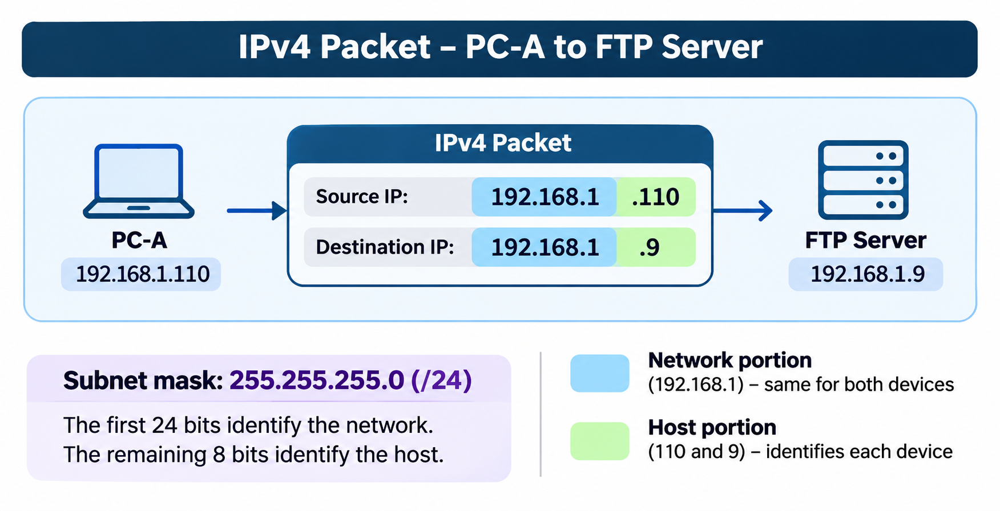

# 🌐 3.7 Data Access

**Cisco Networking Academy | Solent University**

**Course:** CCNA: Introduction to Networks  
**Module:** 03 - Protocols and Models  
**Focus Area:** IP Addresses, MAC Addresses and Local vs Remote Network Communication

## 🎯 Objective

Understand how IP and MAC addresses work together to deliver data, and how devices communicate within the same network or across different networks using routers.

## 🧠 3.7.1 Addresses

When data travels across a network, devices need to know **where it is going and how to deliver it**.

Network communication uses two important types of addresses: 

### Network Layer (Layer 3):
- Uses source and destination IP addresses to identify where the packet comes from and where it needs to go.

### Data Link Layer (Layer 2): 
- Uses source and destination MAC addresses (on Ethernet) to identify which device sends the frame and which device receives it on the current local link.

Both addresses are used during network communication, but they perform different jobs.

## 🧠 3.7.2 Layer 3 Logical Address (IP Address)

An **IP address** is a logical address used to identify a device's network interface and support communication between networks.

IPv4 uses **32-bit addresses**, while IPv6 uses **128-bit addresses**.

An IP packet normally contains:
- **Source IP Address:** The device that sent the packet.
- **Destination IP Address:** The device the packet is intended to reach.

**Example:**
Your computer sends data to a web server.
- Source IP: `192.168.1.10`
- Destination IP: `203.0.113.20`

The IP addresses help network devices determine where the packet came from and where it needs to go.

### Network and Host Portions of an IPv4 Address

An IPv4 address has two parts:

- **Network Portion:** Identifies the network the device belongs to.
- **Host Portion:** Identifies the individual device within that network.

The **subnet mask** determines which bits belong to each portion.

**Example:**
- Source IP: `192.168.1.10`
- Destination IP: `203.0.113.20`
- Subnet Mask: `255.255.255.0 (/24)` for both addresse

| Address | Network Portion | Host Portion |
|---|---|---|
| Source IP | `192.168.1` | `10` |
| Destination IP | `203.0.113` | `20` |

## 🧠 3.7.3 Devices on the Same Network

⚠️ When two devices belong to the **same IP network**, they can normally communicate directly over their local network **without sending the traffic through a router.**

**Example:**

| Device | IP Address | Subnet Mask |
|---|---|---|
| PC-A | `192.168.1.110` | `255.255.255.0` |
| FTP Server | `192.168.1.9` | `255.255.255.0` |

Both devices belong to the network `192.168.1.0/24`.

PC-A recognises that FTP Server is on the same IP network and sends the data directly using the local network.

## 🧠 3.7.4 Role of the Data Link Layer Addresses - Same IP Network

⚠️ When two devices communicate on the same Ethernet network, they use **MAC addresses** to deliver frames locally.

**Example:** PC-A wants to send data to PC-B.

1. PC-A checks PC-B's destination IP address and determines that it is on the same network.
2. PC-A uses **ARP (Address Resolution Protocol)** to discover PC-B's MAC address, if it is not already known.
3. PC-A creates an Ethernet frame containing:
   - **Source MAC:** PC-A's MAC address.
   - **Destination MAC:** PC-B's MAC address.
4. The switch forwards the frame towards PC-B.

**Important:** The IP packet still contains PC-A's source IP and PC-B's destination IP.

### Ethernet Frame – MAC Address Order

In an Ethernet frame, the destination MAC address comes first, followed by the source MAC address.

1. Destination MAC – Where is the frame going?
2. Source MAC – Who sent the frame?

## 🧠 3.7.5 Devices on a Remote Network

⚠️ When two devices belong to **different IP networks**, they normally need a router to communicate.

**Example:**

| Device | IP Address | Network |
|---|---|---|
| PC-A | `192.168.1.10/24` | `192.168.1.0/24` |
| PC-B | `192.168.2.20/24` | `192.168.2.0/24` |
| Router (Interface 1) | `192.168.1.1/24` | `192.168.1.0/24` |
| Router (Interface 2) | `192.168.1.1/24` | `192.168.1.0/24` |

PC-A recognises that PC-B is on a different network.

Instead of sending the Ethernet frame directly to PC-B, PC-A sends it to its **default gateway**, normally a router interface.

**Default Gateway:** The router used to reach destinations outside the local network when no more specific route applies.

## 🧠 3.7.6 Role of the Network Layer Addresses

The **Network layer (Layer 3)** uses IP addresses to identify the original source and final destination of a packet.

When a packet travels through routers, its source and destination IP addresses normally remain the same.

**Example:**

PC-A sends data to PC-B through a router.

| Address | Value |
|---|---|
| Source IP | `192.168.1.10` |
| Destination IP | `192.168.2.20` |

These addresses normally remain unchanged as the packet travels between networks.

Each router examines the destination IP address and uses its **routing table** to determine where to forward the packet.

**Remember:** IP addresses identify the packet's original source and intended destination, while routers determine the path between networks.

## 🧠 3.7.7 Role of the Data Link Layer Addresses - Different IP Networks

When a packet travels between different Ethernet networks, the **MAC addresses change at each routed hop**.

This happens because Ethernet frames are used for delivery over individual local links.

**Example:** PC-A → Router → PC-B

**HOP 1 - First Link: PC-A to Router**
- Source MAC: PC-A
- Destination MAC: Router's interface on PC-A's network

Routers do not normally perform full de-encapsulation. Instead, they remove the incoming Data Link frame, examine the IP packet, and create a new frame with updated source and destination MAC addresses for the next link.

**HOP 2 - Second Link: Router to PC-B**
- Source MAC: Router's interface on PC-B's network
- Destination MAC: PC-B

**⚠️ NOTE:**
- **IP Addresses:** Normally remain the same from source to destination.
- **MAC Addresses:** Change when a router forwards the packet onto another Ethernet link.

## 🧠 3.7.8 Data Link Addresses

A **MAC (Media Access Control) address** is a Layer 2 address commonly used to identify network interfaces on Ethernet and Wi-Fi networks.

MAC address is a 48-bit hardware address, written in hexadecimal (numbers 0–9 and letters A–F), typically printed by the manufacturer on the device's **Network Interface Card (NIC)**.

**Example:** 00:1A:2B:3C:4D:5E

MAC addresses are used to deliver frames over local network links.

**Important Characteristics:**
- Ethernet switches use MAC addresses to forward frames.
- MAC addresses are typically associated with network interfaces.
- MAC addresses may be assigned by manufacturers or configured or randomised by software.
- MAC addresses are not used by internet routers to identify the final destination across multiple networks.

## 📌 Key Concepts to Remember

- **IP Address:** Layer 3 logical address used for communication across IP networks.
- **MAC Address:** Layer 2 address used for local frame delivery.
- **Same IP Network:** Devices can normally communicate directly without a router.
- **Remote IP Network:** Devices normally communicate through a router.
- **Default Gateway:** Router used to reach remote destinations.
- **ARP:** Resolves an IPv4 address to a MAC address on the local link.
- **Routing Table:** Helps routers determine where to forward packets.
- **Source and Destination IP:** Normally remain unchanged during routing.
- **Source and Destination MAC:** Are replaced when a packet is forwarded onto another Ethernet link.
- **Frame:** Carries a packet across a local Data Link connection.

## 🔐 Security Relevance

- **MAC Spoofing:** An attacker may change or imitate a device's MAC address.
- **ARP Spoofing:** An attacker may send false ARP information to redirect local network traffic.
- **IP Spoofing:** An attacker may forge a source IP address to hide or misrepresent where traffic originated.
- **Network Segmentation:** Separating devices into different networks or VLANs can help control access and limit the spread of attacks.
- **Traffic Analysis:** Understanding IP and MAC addressing helps security professionals investigate suspicious packets and network behaviour.